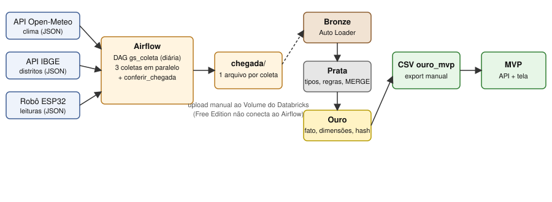

# Dados

Pipeline que coleta clima (Open-Meteo) e distritos de SP (IBGE) com Airflow e trata no Databricks em Bronze, Prata e Ouro. O resultado alimenta a tela do MVP.

## Pastas
- `dags/`: DAG do Airflow (`gs_coleta.py`) e funções de coleta (`coleta.py`)
- `databricks/`: notebooks `01_bronze`, `02_prata`, `03_ouro` e `04_consultas.sql`
- `amostras/`: um arquivo de cada fonte
- `assets/`: prints da execução
- `docs/`: diagrama e relatório em PDF

As leituras do robô (`robo/`) ainda não existem em campo, então os arquivos são gerados por uma função em `dags/coleta.py` (sorteio com semente fixa), no formato do endpoint `POST /robo` do MVP. O firmware atual do robô (`maker/`) não envia nada à internet, então essa fonte segue simulada.

## Como rodar
1. `pip install apache-airflow requests` (Python 3.12) e `airflow standalone`; ativar a DAG `gs_coleta`. Os arquivos caem em `/tmp/chegada` (muda na Variable `CHEGADA_DIR`).
2. Subir as pastas `clima/`, `distritos/` e `robo/` de um lote no Volume `workspace.gs.chegada` e rodar `01_bronze.py`; depois repetir com o lote 2.
3. Rodar `02_prata.py`, `03_ouro.py` e as consultas de `04_consultas.sql`.
4. Baixar o resultado de `SELECT * FROM workspace.gs.ouro_mvp` em CSV e salvar em `mvp/data/ouro_resumo.csv`.
