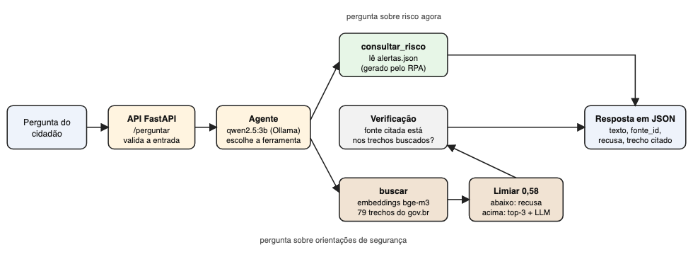

# IA generativa: assistente de orientação do ChuvaRota

Assistente que responde o que fazer em chuva forte e alagamentos usando só orientações oficiais (gov.br), cita a fonte e recusa o que não está na base. Também responde o risco de chuva agora por região, lendo o `alertas.json` que o RPA gera.

Integrante: Vinicius Barros, RM 97824

Relatório completo: [RELATORIO.md](RELATORIO.md)



## Resultado (27 casos de teste, modelo qwen2.5:3b local)
| | acertos | alucinações | citação certa |
|---|---|---|---|
| A sem contexto | 30% | 44% | 0% |
| B RAG simples | 78% | 0% | 71% |
| C RAG + agente | 89% | 0% | 86% |

## Pastas
- `base/` trechos (`trechos.jsonl`), textos de origem (`brutos/`) e `montar_base.py`
- `avaliacao/` casos de teste com gabarito (`casos.json`), `placar.csv` e `resultados.json`
- `notebooks/` `01_base_e_busca` e `02_geracao_e_placar`, já executados
- `src/` busca, ligação com o modelo, as 3 configurações, avaliação e a API
- `tests/` testes da API

## Como reproduzir
Precisa de Python 3.11 ou mais novo e do [Ollama](https://ollama.com).
```
ollama pull qwen2.5:3b
ollama pull bge-m3
pip install -r ia/requirements.txt
python ia/base/montar_base.py          # opcional: refaz a base a partir de ia/base/brutos
cd ia/notebooks && python gerar_notebooks.py   # roda os 2 notebooks e salva as saídas
```
API:
```
cd ia/src && uvicorn api:app --port 8001
curl -X POST localhost:8001/perguntar -H 'content-type: application/json' -d '{"pergunta": "Posso atravessar de carro uma rua alagada?"}'
```

## Links
- Repositório: https://github.com/ViniciusBarrosFiap/chuvarota (pasta `ia/`)
- Vídeo: https://github.com/ViniciusBarrosFiap/chuvarota/blob/main/ia/assets/video_ia.mp4
