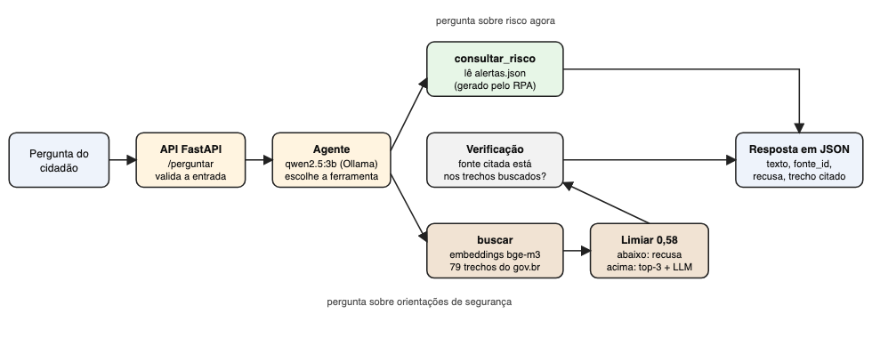

# Generative AI for Engineering: assistente do ChuvaRota

Global Solution 2026.2 · Engenharia de Software · 4º ano

## 1. Integrantes
Vinicius Barros, RM 97824

## 2. Ficha técnica: o que a IA resolve
- **Produto:** ChuvaRota, risco de chuva por região de São Paulo.
- **Tema (dos 3 da atividade):** segurança e mobilidade em chuva forte e alagamentos.
- **Problema:** o cidadão que se desloca a pé ou de ônibus não sabe o que fazer quando a rua alaga e encontra orientação solta, às vezes errada ou sem fonte.
- **O que a IA faz:** responde perguntas sobre o que fazer em alagamentos e enchentes usando somente orientações oficiais, cita a fonte e o trecho usado, e recusa o que não consta. Também diz o risco de chuva agora em cada região, consultando os alertas gerados pelo RPA.
- **Modelo:** qwen2.5:3b rodando local no Ollama (temperatura 0). Embeddings: bge-m3, também local.
- **Especialização:** agente com duas ferramentas (`consultar_risco` e `buscar`) e verificação da fonte. Não treinei LoRA: a atividade aceita agente e ele atende melhor este caso, porque o risco muda a cada 3 horas e não dá para "ensinar" o modelo uma vez.

## 3. Pipeline de IA

1. A API `POST /perguntar` valida a entrada (3 a 300 caracteres).
2. O agente escolhe a ferramenta. Para `consultar_risco`, a região precisa aparecer na pergunta do cidadão (senão o modelo pode inventar o argumento).
3. Para `buscar`, a pergunta vira embedding e traz os 3 trechos mais parecidos. Se a melhor nota for menor que 0,58, a resposta é "não consta" e o modelo nem é chamado.
4. O modelo responde em JSON (`resposta`, `fonte_id`, `recusa`) usando só os trechos.
5. A verificação confere se a fonte citada está entre os trechos buscados e se a resposta tem palavras do trecho. Se não, recusa.
6. A API devolve a resposta, a fonte e o trecho citado (explicável).

## 4. Base de conhecimento
79 trechos literais, cada um com id, fonte e link (`ia/base/trechos.jsonl`). Cortei as páginas por frase e deixei de fora trechos que repetiam outro quase igual e títulos em forma de pergunta.

| Fonte | Formato | Licença | Trechos |
|---|---|---|---|
| Como agir: Alagamentos (MDR, 2021) | PDF | licença do portal gov.br | 37 |
| Como agir: Inundações (MDR) | PDF | licença do portal gov.br | 6 |
| Medidas de autoproteção em alagamentos (gov.br, 2022) | página HTML | Creative Commons Atribuição-SemDerivações 3.0 | 14 |
| Prevenção da leptospirose em enchentes (Ministério da Saúde, 2022) | página HTML | Creative Commons Atribuição-SemDerivações 3.0 | 18 |
| Como me proteger da leptospirose (Ministério da Saúde, 2024) | página HTML | Creative Commons Atribuição-SemDerivações 3.0 | 4 |

Como a licença não permite derivações, os trechos são cópias literais com a fonte citada, sem reescrever.

## 5. Casos de teste e métricas
27 casos em `ia/avaliacao/casos.json`, com gabarito:
- 18 perguntas com resposta na base (termos esperados e trechos corretos);
- 6 perguntas que **não constam** na base (a resposta certa é recusar);
- 3 perguntas sobre o risco de chuva agora (a resposta certa vem do `alertas.json`).

Busca (18 perguntas com resposta):

| Busca | recall@1 | recall@3 |
|---|---|---|
| palavras (TF-IDF) | 10/18 (55%) | 16/18 (88%) |
| semântica (bge-m3) | 17/18 (94%) | 17/18 (94%) |

**Limiar 0,58.** As notas das perguntas sem resposta ficaram entre 0,42 e 0,57 e as das perguntas com resposta entre 0,57 e 0,78. Com 0,58 todas as 6 sem resposta são barradas e só 1 com resposta é perdida. Para um assistente de segurança é melhor recusar do que inventar.

## 6. Placar das três configurações
| | acertos | acerto com fonte certa | alucinações | JSON válido | citação certa | recusa correta |
|---|---|---|---|---|---|---|
| A sem contexto | 30% | 0% | 44% | 100% | 0% | 0% |
| B RAG simples | 78% | 78% | 0% | 100% | 71% | 100% |
| C RAG + agente | 89% | 89% | 0% | 100% | 86% | 100% |

Por tipo (acertos):

| | com resposta (18) | não consta (6) | risco atual (3) |
|---|---|---|---|
| A sem contexto | 8 | 0 | 0 |
| B RAG simples | 15 | 6 | 0 |
| C RAG + agente | 15 | 6 | 3 |

**Interpretação.**
- O modelo sem contexto responde tudo com segurança: nas 6 perguntas que não constam, respondeu as 6. Ele inventou "30 centímetros", falou que o risco na Mooca era "moderado" (o dado real era "baixo") e disse que o seguro "geralmente cobre" enchente. Nada disso tem fonte.
- O RAG simples zerou as alucinações e passou a citar a fonte, mas não sabe responder o risco atual (0 de 3), porque esse dado não está nos documentos.
- O agente manteve zero alucinação e acertou as 3 perguntas de risco atual. Em orientações ele empatou com o RAG (15 de 18): o ganho veio da ferramenta, não da busca.
- O "acerto" é medido por palavras-chave do gabarito, então uma resposta correta com outras palavras conta como erro, principalmente na configuração A.
- Na pergunta sobre vacina, o modelo sem contexto disse que não existe vacina para humanos, o que pode até ser verdade, mas não está na base e ficou sem fonte. Foi contada como alucinação porque o assistente só pode afirmar o que a base sustenta.

**Limites desta avaliação.** São só 27 casos. Alguns ajustes (exemplos no prompt, validação da região, verificação sem LLM, limiar) foram feitos olhando os erros destes mesmos casos, então os números são otimistas. O certo seria revalidar com perguntas novas.

## 7. Cinco erros reais e correções propostas
| # | Erro (saída real) | Causa | Correção |
|---|---|---|---|
| 1 | Config A, caso 19: "Um carro pode ser arrastado por até 30 centímetros de água" | O modelo responde de memória e sem fonte; o número não está na base | RAG com recusa: B e C recusaram. Reforço: exigir `fonte_id` em toda resposta |
| 2 | Config A, caso 25: risco "moderado" na Mooca (real: baixo) | Dado em tempo real que o modelo não tem | Ferramenta `consultar_risco`: C respondeu "baixo (0.0 mm em 3 h)" |
| 3 | Agente v1: respondeu o risco de "Santo Amaro" para perguntas sem região (travessia de rua, área de risco da casa, aparelhos elétricos, volta para casa) | O roteador inventou o argumento da ferramenta | Corrigido: a região só vale se aparecer na pergunta do cidadão |
| 4 | B e C, caso 13 (roedores): "Não consta", embora o trecho `lepto_medidas-10` exista | O modelo de 3 bilhões de parâmetros recusa quando a pergunta ("evitar") usa palavras diferentes do trecho ("prevenir infestação") | Proposto: modelo maior (7B), mais exemplos de resposta positiva no prompt e reescrita da pergunta pelo agente |
| 5 | B e C, caso 17 (ajuda extra): "Não consta", abaixo do limiar | A nota foi 0,57, abaixo de 0,58, e o trecho existe | Proposto: calibrar o limiar com mais perguntas ou usar um reranking antes de recusar |

Outros erros que continuam: o caso 12 (inundação x enxurrada) exige juntar 2 trechos e o modelo recusa (proposta: aumentar `k` para 5 e pedir síntese).

## 8. Segurança, explicabilidade e LGPD
- **Roda local:** o modelo e os embeddings ficam no Ollama; nenhuma pergunta sai da máquina.
- **Sem dado pessoal:** a base tem só orientações públicas e a API não grava as perguntas.
- **Explicável:** toda resposta traz a fonte e o trecho citado; sem fonte, ela recusa.
- **Entrada validada:** de 3 a 300 caracteres; erro do modelo vira 503, sem expor detalhes.
- **Pessoa no circuito:** a base inclui os telefones de emergência (Defesa Civil 199, Bombeiros 193); em risco real a orientação é ligar, não depender do assistente.

## 9. Conclusão técnica
Com o mesmo modelo pequeno, dar contexto e permitir recusa tirou as alucinações (de 44% para 0%) e trouxe a citação da fonte; a ferramenta de risco cobriu o que a base não tem. Os pontos fracos são o modelo pequeno, que ainda recusa perguntas que a base responde, e a avaliação com poucos casos.

## 10. Links
- Repositório: https://github.com/ViniciusBarrosFiap/chuvarota (pasta `ia/`)
- Vídeo: https://github.com/ViniciusBarrosFiap/chuvarota/blob/main/ia/assets/video_ia.mp4
