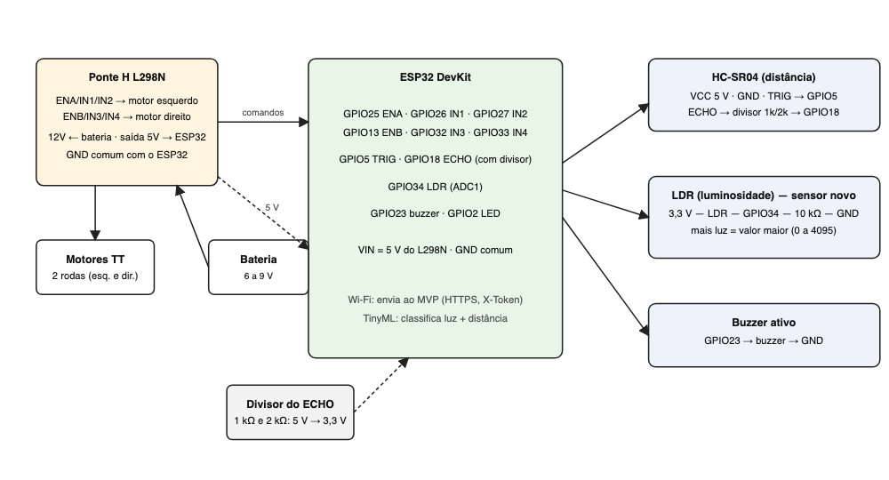
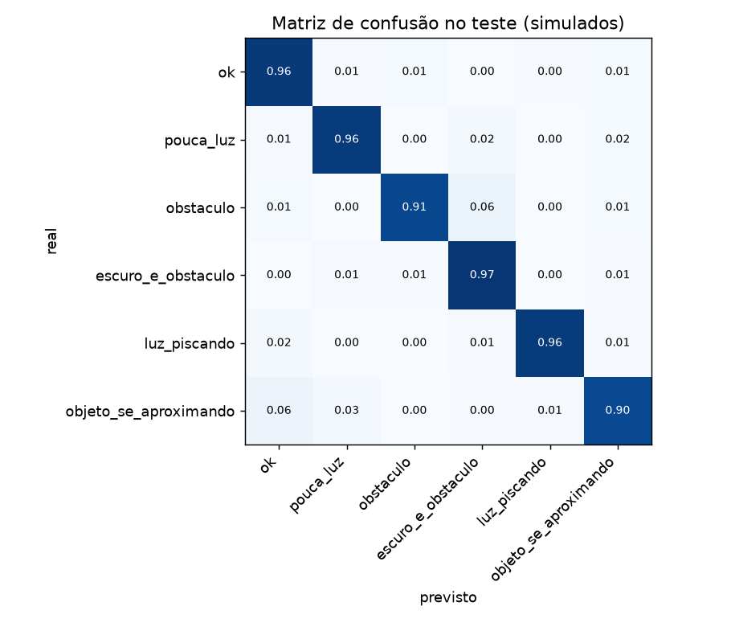
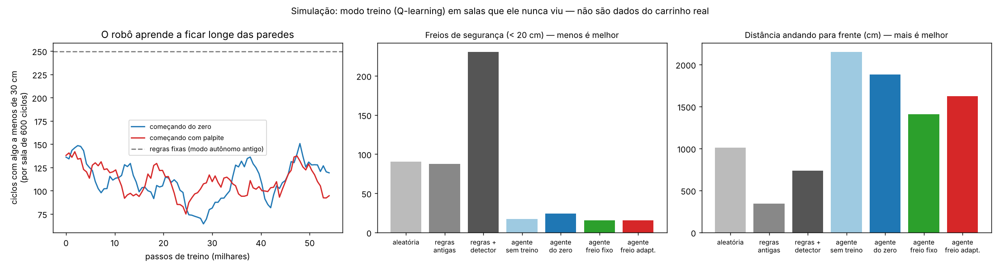

# Carro robô ChuvaRota (Project-Based Maker Lab)

Integrante: **Vinicius Barros, RM 97824**

Carro robô com ESP32 **controlado pelo app Dabble** (Bluetooth), que também pode andar sozinho, desvia de obstáculos, mede a luz do ambiente com um **LDR (sensor novo)** e usa um **modelo TinyML** para entender o que está acontecendo. Quando acha uma situação de risco (ponto escuro com obstáculo, lâmpada piscando, algo vindo rápido), o robô reage e manda um alerta ao MVP do ChuvaRota, que mostra as leituras em tempo real.

> **Estado atual:** firmware, modelo TinyML e integração com o MVP estão prontos e testados no computador (o firmware compila, o C++ decide igual ao Python e o endpoint está no ar no Azure). **O carrinho ainda não foi montado**, então nada foi testado no hardware: a seção "Resultados com o robô" abaixo será preenchida depois dos testes de bancada.

## Montar e gravar (resumo)
1. Ligar as peças fio a fio com o [docs/montagem.md](docs/montagem.md) (esquema geral em [docs/ligacao.png](docs/ligacao.png)).
2. Pelo **Arduino IDE** (passo a passo em [docs/teste_pecas.md](docs/teste_pecas.md)): instalar a biblioteca **DabbleESP32**, escolher a partição **Huge APP**, abrir `maker/firmware/robo/robo.ino`, copiar `wifi_local.example.h` para `wifi_local.h` (na mesma pasta) com o seu Wi-Fi e clicar em Upload. Ou, pelo terminal, com o ESP32 por USB (cabo de dados):
```
./maker/firmware/configurar.sh     # pergunta o Wi-Fi (2,4 GHz) e cria o wifi_local.h (o token do MVP já está no config.h)
./maker/firmware/gravar.sh         # compila, grava e abre o Monitor Serial
```
3. Antes disso, se quiser testar cada peça sozinha: `./maker/firmware/gravar.sh teste_pecas`.

Depois, abra o app **Dabble** no celular e conecte em **ChuvaRota** ([docs/dabble.md](docs/dabble.md)).

Não precisa calibrar o LDR (o robô aprende o mais escuro e o mais claro que vê) nem mexer no código: motor ao contrário, velocidade e tempo de giro se ajustam no `config.h`.

## Problema (CitizenTech)
Pontos de ônibus, calçadas e ruas mal iluminados, principalmente em dia de chuva e à noite, aumentam o risco de acidentes e de crimes, e a prefeitura só descobre quando alguém reclama. O robô percorre o local, mede a luz e a distância até os obstáculos e avisa onde precisa de atenção, inclusive lâmpadas com defeito. Contribui para os ODS 11 (cidades sustentáveis) e 9 (infraestrutura).

## Componentes
| Peça | Função |
|---|---|
| ESP32 DevKit | cérebro: lê os sensores, roda o TinyML, comanda os motores e fala com o MVP por Wi-Fi |
| Chassi 2WD com 2 motores TT | locomoção |
| Ponte H L298N | aciona os motores e fornece 5 V para o ESP32 |
| HC-SR04 | distância até obstáculos (o ECHO passa por divisor de tensão 1k/2k) |
| **LDR + resistor de 10 kΩ** | **sensor novo: luminosidade do ambiente** |
| Buzzer ativo | alerta sonoro |
| Bateria de 6 a 9 V | alimentação |
| Celular com o app **Dabble** | controle por Bluetooth (joystick, setas e botões) |



## Como funciona
1. A cada 100 ms o robô lê a distância (mediana de 3 medidas) e a luz (média de 8 leituras, normalizada de 0 a 1 pela autocalibração).
2. Guarda as últimas 8 leituras (0,8 s) e calcula 5 características: luz média, oscilação e amplitude da luz, distância mediana e a velocidade com que a distância muda.
3. O modelo TinyML escolhe uma de 6 situações:

| classe | significado | o que o robô faz |
|---|---|---|
| `ok` | claro e caminho livre | anda em velocidade normal |
| `pouca_luz` | ambiente escuro, caminho livre | anda devagar e acende o LED |
| `obstaculo` | algo a menos de 30 cm | recua e vira |
| `escuro_e_obstaculo` | escuro com algo à frente | para, apita 3 vezes, manda alerta na hora e desvia |
| `luz_piscando` | a luz oscila (lâmpada com defeito) | segue devagar e avisa ao MVP (no máximo a cada 30 s) |
| `objeto_se_aproximando` | algo vem rápido na direção do robô | freia e recua antes de chegar perto |

4. Uma regra de segurança fica **acima** do modelo: a menos de 25 cm (`DIST_MINIMA_CM`) o robô para, mesmo que o modelo erre. No modo autônomo ele então **recua, vira para o lado** (alternando esquerda e direita) e só segue quando houver 40 cm livres à frente. Um "sem eco" logo depois de uma leitura perto conta como obstáculo, e não como caminho livre. Situações de risco valem na hora; as demais só trocam depois de 2 decisões iguais seguidas.
5. Outra tarefa do ESP32 envia a situação ao MVP a cada 5 s (e na hora no caso de alerta), por HTTPS com a hora acertada por NTP, sem travar o robô.

**Controle pelo Dabble e autonomia:** por padrão o carrinho é dirigido pelo app Dabble (Bluetooth), e o **triângulo** alterna para o modo **autônomo**, em que ele decide sozinho com os sensores e o TinyML. Mesmo dirigido à mão, o robô não bate de frente (ele para a 25 cm), classifica o ambiente e manda os alertas ao MVP. Botões e ajustes em [docs/dabble.md](docs/dabble.md).

## TinyML
- Rede neural pequena: 5 entradas, camadas de 16 e 8 neurônios (ReLU) e 6 saídas, **286 parâmetros (cerca de 1 KB)**. O treino é em Python (`tinyml/treinar.py`, scikit-learn) e o resultado vira um arquivo C++ (`firmware/robo/modelo_tinyml.h`) que roda no ESP32 sem biblioteca nenhuma.
- **Dados: simulados**, porque o robô ainda não existe. `tinyml/simular_sensores.py` simula a rua (luz e distância verdadeiras) e as leituras com os defeitos dos sensores: ruído do LDR, calibração errada em ±8%, HC-SR04 que às vezes não ouve eco ou lê um valor falso, lâmpada que pisca e objetos que se aproximam. São 5.000 episódios de 40 s (346,500 janelas de treino, 74,250 de validação e 74,250 de teste, separados por episódio). Os rótulos vêm dos limites que eu defini (escuro: luz menor que 0,30; obstáculo: menos de 30 cm; aproximando: mais de 40 cm/s a menos de 100 cm).
- **Treino com ruído variado** (0,5 a 3 vezes o previsto) e busca de hiperparâmetros: 27 arquiteturas na primeira rodada (todas empataram em F1 entre 0,91 e 0,93; a maior, com 2.662 parâmetros, ficou menos robusta ao ruído) e uma segunda rodada focada. Escolhi o **menor modelo dentro de 0,003 do melhor**.
- O modelo escolhido foi comparado com duas soluções clássicas, no mesmo teste:

| | acerto | F1 macro |
|---|---|---|
| decidir só pela última leitura (sem janela) | 81,7% | 0.57 |
| limites fixos sobre as mesmas características | 87,1% | 0.81 |
| **modelo TinyML** | **95,1%** | **0.93** |

- **Robustez** (F1 macro com sensores mais ruidosos que o previsto): ruído 1x: modelo 0.93 contra 0.81 das regras; 2x: 0.91 contra 0.81; 3x: 0.89 contra 0.79.
- Pior classe: `objeto_se_aproximando` (precisão 0.80, recall 0.90), porque o limite entre "aproximando" e "obstáculo" é difuso.



- `tinyml/testar_c.py` compila o C++ do robô no computador e confere que ele decide **igual** ao Python a partir das leituras brutas (100% de 400 janelas).
- **Limite importante:** esses números medem o quanto o modelo lida com ruído e falhas que **eu simulei**, não o desempenho no robô. Quando o carrinho estiver montado, o `tinyml/coletar.py` grava dados reais (passos em [docs/teste_pecas.md](docs/teste_pecas.md)) e o `treinar.py` passa a usá-los automaticamente.

## Modo treino e modo IA (aprendizado por reforço)
Além do TinyML (que **classifica** a situação), o robô tem um segundo tipo de IA que **aprende por tentativa e erro** a andar no ambiente em que está (`firmware/robo/aprendizado.h`, Q-learning):
- **Treino** (botão **círculo** no Dabble, ou `a` no Monitor Serial): a cada 0,1 s ele olha a distância (em 6 faixas, mais se está se aproximando ou se afastando e o que fez por último), escolhe uma ação (frente, frente devagar, girar à esquerda, girar à direita ou ré) e recebe uma nota no ciclo seguinte: ganha pontos andando livre e perde ao chegar perto de uma parede ou ao mandar andar e não sair do lugar. Com isso atualiza uma tabela de 72 situações x 5 ações. Além disso ele aprende o **próprio freio** (veja abaixo). No começo ele testa ações aleatórias (o **LED da placa acende** nesses ciclos) e vai testando menos. Cada **freio de segurança** (algo a menos de 20 cm) é um erro e faz um bip curto: dá para ouvir os erros diminuindo.
- **IA** (botão **Start**, ou `u`): usa a tabela aprendida sem explorar e sem mudar nada.
- A tabela fica na **memória flash** (continua depois de desligar). `q` mostra a melhor ação aprendida para cada situação, `e` imprime a curva de aprendizado em CSV e `z` apaga tudo (use ao levar o carrinho para um ambiente novo). A cada 300 passos o Monitor Serial mostra `treino: bloco N | exploração | nota média | quase-batidas | freios`.
- **Segurança:** o freio (recua um pouco) e a fuga de cantos (5 freios em 30 ciclos, ou mandar andar e a distância não mudar por 3 ciclos) **não são aprendidos**: valem mais que o agente. Todos os modos também usam o filtro "sem eco logo depois de algo perto = obstáculo".
- **O que ele aprende e o que não aprende:** o carrinho tem um sensor só, olhando para frente, e nada que meça o quanto andou. Ele aprende **reflexos** para o ambiente (o que fazer ao ver uma parede a tantos cm), e **não faz um mapa** do lugar. O carrinho só sabe que errou quando algo chega perto, então o treino precisa de um espaço onde ele possa errar sem se machucar (uns 10 a 20 minutos).
- **Freio que se ajusta sozinho:** o freio de segurança começa a 20 cm. A cada freada o robô para, mede de novo e vê quanto espaço sobrou entre o carrinho parado e o obstáculo. Se sobrou mais de 10 cm, da próxima vez freia 1 cm mais perto; se parou a menos de 6 cm (ou o sensor perdeu o eco), freia 2 a 3 cm mais longe. Nunca fica fora de 12 a 30 cm (`TREINO_MARGEM_MIN_CM` e `TREINO_MARGEM_MAX_CM` no `config.h`; `TREINO_ADAPTAR_MARGEM 0` desliga). As faixas de distância e as notas do aprendizado andam junto com esse freio. O Monitor Serial mostra `freio: parou a X cm do obstáculo | distância do freio A -> B cm`. O modo autônomo continua com a margem fixa de 25 cm.
- **Resultado na simulação** (`python maker/tinyml/simular_treino.py`: salas retangulares com obstáculos, o mesmo código do robô, 3 treinos de 60 mil passos, avaliação em 100 salas novas por treino, 600 ciclos por sala): comparado ao modo autônomo antigo (regras fixas), o agente treinado precisou de **cerca de 6 vezes menos freios de segurança** (15 contra 87 por sala), **andou 4,7 vezes mais** (1.620 contra 345 cm) e **visitou 4 vezes mais cantos da sala**. A maior parte da melhora vem nos primeiros 5 mil passos. Ele **ainda raspa em paredes** (47 ciclos com o movimento barrado por sala, contra 387 nas regras antigas e 16 nas regras com o detector de travamento), porque o sensor não enxerga de lado. O freio adaptativo foi de 20 para uns 12 cm (o mínimo) na maioria dos treinos, mas **na simulação isso não deu um ganho claro** em relação ao freio fixo em 20 cm: nas salas normais andou um pouco mais (1.620 contra 1.410 cm), nas salas apertadas ficou igual (770 contra 750 cm) e **ficou a menos de 8 cm do obstáculo em mais ciclos nas salas apertadas** (56 contra 25 por sala). Ou seja, ele chega mais perto, como pedido, mas o ganho de espaço não apareceu nos números simulados; no carrinho real o freio pode se ajustar para outro valor, porque lá vale a freada de verdade. Esses números são da **simulação**: no carrinho real ainda não foram medidos.
- **Calibração do carrinho real** (comandos no Monitor Serial, no modo manual, sem trocar de programa nem mexer nos fios): `p` mede o quanto o sensor oscila num alvo parado (uma leitura, mediana de 3 e o método novo); `k` calibra o sensor com a parede a 20, 50 e 100 cm (régua) e imprime `SENSOR_ESCALA` e `SENSOR_OFFSET_CM` para o `config.h`; `v` mede a velocidade do carrinho usando o próprio sensor contra uma parede; `g` mede o giro pela mudança da distância até a parede. Os valores de `v` e `g` (`CARRINHO_CM_S_NORMAL`, `CARRINHO_CM_S_LENTO`, `CARRINHO_GRAUS_S`) vão para o `config.h` e a simulação do treino passa a usar os números do carrinho real. `?` lista os comandos.
- **Sensor mais preciso:** o robô faz 3 leituras e, se elas não concordam, até 5; descarta as que fogem da mediana e usa a média das que concordam; a velocidade do som é corrigida pela temperatura (`TEMPERATURA_C`) e há uma pausa entre as leituras para o eco anterior sumir. Depois de frear e nas calibrações, com o carrinho parado, ele usa 7 leituras. Em ruído simulado (`python maker/tinyml/testar_sensor.py`) a oscilação caiu uns 20% (0,88 para 0,71 cm a 50 cm) e as **leituras falsas que passavam caíram de 32 para 1 em 20 mil**. Na placa real, quem mede é o comando `p`.



## Integração com o MVP
`POST /robo` recebe `{luz_pct, distancia_cm, situacao}` com o cabeçalho `X-Token`; `GET /robo` devolve as últimas leituras, que aparecem na tela inicial do MVP: https://chuvarota-85ixn.azurewebsites.net

- O token do robô está em `config.h`, versionado de propósito para quem avaliar poder reproduzir. É um **token de demonstração**: só permite enviar leituras de teste ao MVP de demonstração (`POST /robo`) e não dá acesso a mais nada. No Azure ele é configurado pelo Terraform (`robo_token`); para usar outro MVP, defina outro `ROBO_TOKEN` lá e troque o valor no `config.h`. O **Wi-Fi não vai para o Git**: fica em `wifi_local.h`.
- A conexão com o MVP é criptografada (HTTPS), mas o robô não confere o certificado do servidor: o ESP32 recusava a cadeia do Azure. Limite aceito para a demo; o token só grava leituras de teste.
- Não há dado pessoal: só luz, distância e a classe. O MVP guarda as últimas 50 leituras em memória.

## Pastas
- `firmware/robo/` firmware do robô (`robo.ino`), `caracteristicas.h`, `modelo_tinyml.h` (gerado), `aprendizado.h` (Q-learning dos modos treino e IA), `seguranca.h` (filtro da distância e detector de travamento), `direcao.h` (setas e joystick do Dabble), `config.h` (token de demonstração e ajustes), `wifi_local.example.h`
- `firmware/teste_pecas/` sketch para testar cada peça sozinha
- `firmware/configurar.sh` e `firmware/gravar.sh`
- `tinyml/` simulador dos sensores, características, treino, testes e coleta de dados reais; `mundo_treino.cpp` e `simular_treino.py` (salas simuladas para o modo treino)
- `simulador/` finge ser o robô para testar o endpoint do MVP
- `docs/` montagem fio a fio, controle pelo Dabble, esquema de ligação e testes de bancada

## Testes
- `python maker/tinyml/testar_c.py`: o C++ decide igual ao Python.
- `python maker/tinyml/testar_aprendizado.py`: regras do Q-learning (estados, notas, freio, fuga, tamanho na memória flash).
- `python maker/tinyml/simular_treino.py`: o agente aprende em salas simuladas e erra menos que as regras fixas (gera `treino_simulado.png`).
- `python maker/tinyml/testar_seguranca.py`: o filtro da distância trata "sem eco" logo depois de algo perto como obstáculo.
- `python maker/tinyml/testar_direcao.py`: as setas e o joystick do Dabble viram o movimento certo das rodas (cima = frente, baixo = trás, esquerda e direita = virar para o lado).
- `arduino-cli compile --fqbn esp32:esp32:esp32 maker/firmware/robo` (com um `config.h`): compila.
- `pytest mvp`: o endpoint `/robo` (sem token, token errado, leitura inválida e válida).
- `ROBO_TOKEN=... python maker/simulador/simular_robo.py <url> 8`: manda leituras de teste ao MVP.
- Testes de bancada com as peças: [docs/teste_pecas.md](docs/teste_pecas.md).

## Resultados com o robô
_A preencher depois dos testes de bancada: distâncias medidas, comportamento nas 6 situações, taxa de acerto com dados reais, vídeo._

## Vídeo
Link do vídeo: _a preencher_.
