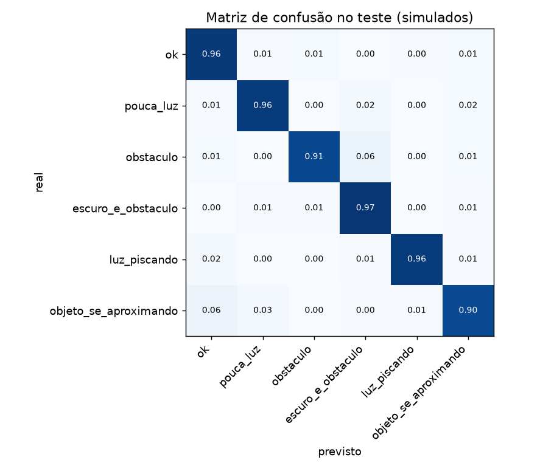
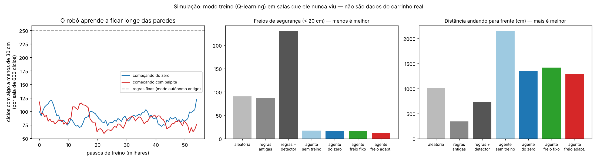

# Como a IA do carrinho funciona

Este arquivo tem os detalhes técnicos. Para usar o carrinho, o [README](../README.md) basta. São **duas IAs** diferentes:

1. **TinyML** (rede neural pequena): olha as últimas leituras e **classifica a situação** (ok, pouca luz, obstáculo...). Roda sempre.
2. **Aprendizado por reforço** (Q-learning): **aprende por tentativa e erro** a andar no ambiente em que está. Roda nos modos treino e IA.

Também há: o sensor de distância mais preciso e os comandos de calibração (no fim deste arquivo).

## TinyML
- Rede neural pequena: 5 entradas, camadas de 16 e 8 neurônios (ReLU) e 6 saídas, **286 parâmetros (cerca de 1 KB)**. O treino é em Python (`tinyml/treinar.py`, scikit-learn) e o resultado vira um arquivo C++ (`firmware/robo/modelo_tinyml.h`) que roda no ESP32 sem biblioteca nenhuma.
- **Dados: simulados**, porque o robô ainda não existe. `tinyml/simular_sensores.py` simula a rua (luz e distância verdadeiras) e as leituras com os defeitos dos sensores: ruído do LDR, calibração errada em ±8%, HC-SR04 que às vezes não ouve eco ou lê um valor falso, lâmpada que pisca e objetos que se aproximam. São 5.000 episódios de 40 s (346,500 janelas de treino, 74,250 de validação e 74,250 de teste, separados por episódio). Os rótulos vêm dos limites que eu defini (escuro: luz menor que 0,30; obstáculo: menos de 30 cm; aproximando: mais de 40 cm/s a menos de 100 cm).
- **Treino com ruído variado** (0,5 a 3 vezes o previsto) e busca de hiperparâmetros: 27 arquiteturas na primeira rodada (todas empataram em F1 entre 0,91 e 0,93; a maior, com 2.662 parâmetros, ficou menos robusta ao ruído) e uma segunda rodada focada. Escolhi o **menor modelo dentro de 0,003 do melhor**.
- O modelo escolhido foi comparado com duas soluções clássicas, no mesmo teste:

| | acerto | F1 macro |
|---|---|---|
| decidir só pela última leitura (sem janela) | 81,7% | 0.57 |
| limites fixos sobre as mesmas características | 87,1% | 0.81 |
| **modelo TinyML** | **95,1%** | **0.93** |

- **Robustez** (F1 macro com sensores mais ruidosos que o previsto): ruído 1x: modelo 0.93 contra 0.81 das regras; 2x: 0.91 contra 0.81; 3x: 0.89 contra 0.79.
- Pior classe: `objeto_se_aproximando` (precisão 0.80, recall 0.90), porque o limite entre "aproximando" e "obstáculo" é difuso.

- `tinyml/testar_c.py` compila o C++ do robô no computador e confere que ele decide **igual** ao Python a partir das leituras brutas (100% de 400 janelas).
- **Limite importante:** esses números medem o quanto o modelo lida com ruído e falhas que **eu simulei**, não o desempenho no robô. Quando o carrinho estiver montado, o `tinyml/coletar.py` grava dados reais (passos em [teste_pecas.md](teste_pecas.md)) e o `treinar.py` passa a usá-los automaticamente.

## Modo treino e modo IA (aprendizado por reforço)
Além do TinyML (que **classifica** a situação), o robô tem um segundo tipo de IA que **aprende por tentativa e erro** a andar no ambiente em que está (`firmware/robo/aprendizado.h`, Q-learning):
- **Treino** (botão **círculo** no Dabble, ou `a` no Monitor Serial): a cada 0,1 s ele olha a distância (em 6 faixas, mais se está se aproximando ou se afastando e o que fez por último), escolhe uma ação (frente, frente devagar, girar à esquerda, girar à direita ou ré) e recebe uma nota no ciclo seguinte: ganha pontos andando livre e perde ao chegar perto de uma parede ou ao mandar andar e não sair do lugar. Com isso atualiza uma tabela de 72 situações x 5 ações. Além disso ele aprende o **próprio freio** (veja abaixo). No começo ele testa ações aleatórias (o **LED da placa acende** nesses ciclos) e vai testando menos. Cada **freio de segurança** (algo a menos de 20 cm) é um erro e faz um bip curto: dá para ouvir os erros diminuindo.
- **IA** (botão **Start**, ou `u`): usa a tabela aprendida sem explorar e sem mudar nada.
- A tabela fica na **memória flash** (continua depois de desligar). `q` mostra a melhor ação aprendida para cada situação, `e` imprime a curva de aprendizado em CSV e `z` apaga tudo (use ao levar o carrinho para um ambiente novo). A cada 300 passos o Monitor Serial mostra `treino: bloco N | exploração | nota média | quase-batidas | freios`.
- **Segurança:** o freio (recua um pouco) e a fuga de cantos (5 freios em 30 ciclos, ou mandar andar e a distância não mudar por 3 ciclos) **não são aprendidos**: valem mais que o agente. Todos os modos também usam o filtro "sem eco logo depois de algo perto = obstáculo".
- **O que ele aprende e o que não aprende:** o carrinho tem um sensor só, olhando para frente, e nada que meça o quanto andou. Ele aprende **reflexos** para o ambiente (o que fazer ao ver uma parede a tantos cm), e **não faz um mapa** do lugar. O carrinho só sabe que errou quando algo chega perto, então o treino precisa de um espaço onde ele possa errar sem se machucar (uns 10 a 20 minutos).
- **Freio que se ajusta sozinho:** o freio de segurança começa a 20 cm. A cada freada o robô para, mede de novo e vê quanto espaço sobrou entre o carrinho parado e o obstáculo. Se sobrou mais de 10 cm, da próxima vez freia 1 cm mais perto; se parou a menos de 6 cm (ou o sensor perdeu o eco), freia 2 a 3 cm mais longe. Nunca fica fora de 14 a 30 cm (`TREINO_MARGEM_MIN_CM` no `config.h`; `TREINO_ADAPTAR_MARGEM 0` desliga). As faixas de distância e as notas do aprendizado andam junto com esse freio. O Monitor Serial mostra `freio: parou a X cm do obstáculo | distância do freio A -> B cm`. O modo autônomo continua com a margem fixa de 25 cm.
- **Resultado na simulação** (`python maker/tinyml/simular_treino.py`: salas retangulares com obstáculos, o mesmo código do robô, 3 treinos de 60 mil passos, avaliação em 100 salas novas por treino, 600 ciclos por sala): comparado ao modo autônomo antigo (regras fixas), o agente treinado precisou de **cerca de 7 vezes menos freios de segurança** (13 contra 87 por sala), **andou 3,7 vezes mais** (1.285 contra 345 cm) e **visitou 3,5 vezes mais cantos da sala**. A maior parte da melhora vem nos primeiros 5 mil passos. Ele **ainda raspa em paredes** (37 ciclos com o movimento barrado por sala, contra 387 nas regras antigas e 16 nas regras com o detector de travamento), porque o sensor não enxerga de lado. O freio adaptativo foi de 20 para 14 cm (o mínimo) nos 3 treinos, mas **na simulação isso não deu um ganho claro** em relação ao freio fixo em 20 cm: nas salas normais andou um pouco menos (1.285 contra 1.418 cm) e nas apertadas um pouco mais (612 contra 555 cm), dentro do ruído. Ele chega mais perto, como pedido, mas o ganho de espaço não apareceu nos números simulados. Esses números são da **simulação**.
- **Calibração do carrinho real** (comandos no Monitor Serial, no modo manual, sem trocar de programa nem mexer nos fios): `p` mede o quanto o sensor oscila num alvo parado (uma leitura, mediana de 3 e o método novo); `k` calibra o sensor com a parede a 20, 50 e 100 cm (régua) e imprime `SENSOR_ESCALA` e `SENSOR_OFFSET_CM` para o `config.h`; `v` mede a velocidade do carrinho usando o próprio sensor contra uma parede; `g` mede o giro pela mudança da distância até a parede. Os valores de `v` e `g` (`CARRINHO_CM_S_NORMAL`, `CARRINHO_CM_S_LENTO`, `CARRINHO_GRAUS_S`) vão para o `config.h` e a simulação do treino passa a usar os números do carrinho real. `?` lista os comandos.
- **Sensor mais preciso:** o robô faz 3 leituras e, se elas não concordam, até 5; descarta as que fogem da mediana e usa a média das que concordam; a velocidade do som é corrigida pela temperatura (`TEMPERATURA_C`) e há uma pausa entre as leituras para o eco anterior sumir. Depois de frear e nas calibrações, com o carrinho parado, ele usa 7 leituras. Em ruído simulado (`python maker/tinyml/testar_sensor.py`) a oscilação caiu uns 20% (0,88 para 0,71 cm a 50 cm) e as **leituras falsas que passavam caíram de 32 para 1 em 20 mil**. Na placa real, quem mede é o comando `p`.

## Primeiro treino no carrinho real
Um treino de **5.076 passos** (uns 10 minutos), medido pelo comando `e` (16 blocos de 300 passos; "quase-batidas" são os ciclos com algo a menos de distância do freio + 10 cm). É **um único treino, em um ambiente que não foi controlado**.

| | Blocos 1 a 3 (primeiros 900 passos) | Blocos 4 a 16 |
|---|---|---|
| Quase-batidas por bloco | 47 em média | 2,4 em média |
| Freios de segurança por bloco | 1,3 | 0,08 |
| Nota média | -0,53 | +0,08 (+0,20 nos blocos 5 a 11) |

- A distância do freio foi de 20 para 16, 12, 14, 16 e 14 cm. Com 12 cm ele parou a menos de 6 cm do obstáculo (o controle subiu para 14), por isso o mínimo do `config.h` passou a 14 cm.
- A política aprendida (comando `q`) é coerente: longe anda, perto gira, e se mandou andar e a distância não muda ele gira.
- **Limite:** não dá para separar o quanto da queda das quase-batidas veio do aprendizado e o quanto veio de o carrinho estar em um espaço mais aberto nos blocos 5 a 11. Para provar o aprendizado, compare o modo IA com o autônomo no mesmo espaço, ou apague (`z`) e treine de novo no mesmo lugar e veja a curva cair outra vez.
