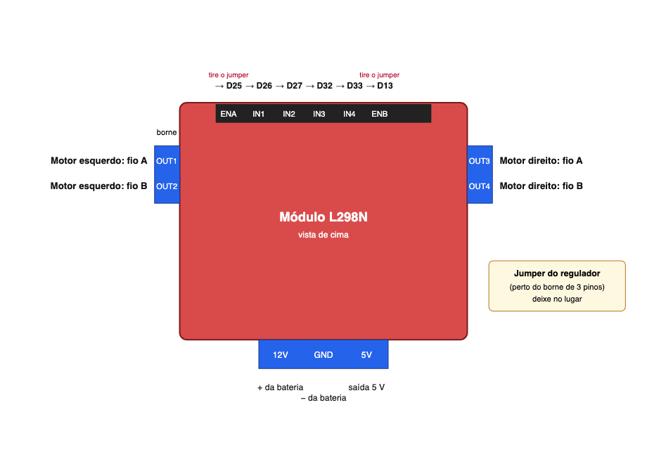
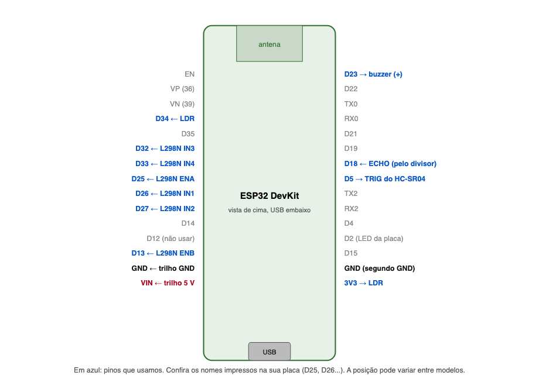

# Montagem do carrinho: ligação fio a fio

Siga na ordem e **deixe a bateria desconectada até o passo 9**. Marque cada fio quando ligar.

## O que você precisa
ESP32, módulo L298N, chassi com 2 motores e rodas, HC-SR04, LDR, buzzer ativo, resistores (**10 kΩ**, **1 kΩ**, **2 kΩ**), capacitor de 470 µF, bateria, protoboard, jumpers (macho-macho e macho-fêmea), cabo USB de dados, chave de fenda pequena (para os bornes do L298N).

Como reconhecer os resistores (faixas de cor, a partir da ponta com as faixas mais juntas):
- **10 kΩ**: marrom, preto, laranja
- **1 kΩ**: marrom, preto, vermelho
- **2 kΩ**: vermelho, preto, vermelho

## 5 regras para não queimar nada
1. **O GND de tudo é o mesmo.** Bateria, L298N, ESP32 e sensores dividem o mesmo GND.
2. **Nenhum pino do ESP32 recebe 5 V.** O ECHO do HC-SR04 só entra pelo divisor de resistores (passo 6).
3. **Nunca ligue o USB e o fio de 5 V do L298N ao mesmo tempo** (fio 3). Veja "Duas formas de alimentar" abaixo.
4. A polaridade importa no **capacitor**, no **buzzer** e na **bateria**. No LDR, nos resistores e nos fios dos motores não importa.
5. Só conecte a bateria no fim, com as rodas **fora do chão**.

## Passo 0: preparar o L298N

- Tire os **dois jumpers (capinhas pretas)** que ficam sobre os pinos **ENA** e **ENB**. Com eles, o motor fica sempre ligado no máximo e o robô não controla a velocidade.
- **Deixe no lugar** o jumper do regulador, perto do borne de 3 pinos (12V, GND, 5V). É ele que gera os 5 V.

## Passo 1: chassi
Fixe os dois motores no chassi e as rodas nos eixos (o robô costuma ter uma terceira roda boba na frente). Se os fios dos motores não vieram soldados, solde um fio em cada terminal metálico do motor. Aperte os fios dos **motores** nos bornes do L298N com a chave de fenda.

## Passo 2: protoboard e ESP32
- Encaixe o ESP32 **atravessando o vão central** da protoboard, com o USB para a borda. Cada pino fica em uma coluna: **ligue os fios nos furos livres da mesma coluna do pino**.
- Use as duas linhas longas das bordas como **trilhos**: o trilho **vermelho (+) será o 5 V** e o **azul (−) será o GND**. Em protoboards de 830 furos, algumas têm o trilho dividido no meio: se for o caso, ligue as duas metades com um jumper.
- Pinos do ESP32: veja o desenho e **confira os nomes impressos na sua placa**.



## Passo 3: alimentação (ainda sem a bateria)
| Fio | Cor sugerida | De | Para |
|---|---|---|---|
| 1 | vermelho | **+ da bateria** | borne **12V** do L298N |
| 2 | preto | **− da bateria** | borne **GND** do L298N |
| 3 | vermelho | borne **5V** do L298N | **trilho +** (5 V) da protoboard |
| 4 | preto | o **mesmo borne GND** do L298N (pode entrar junto com o fio 2) | **trilho −** (GND) |
| 5 | vermelho | **trilho +** | pino **VIN** do ESP32 |
| 6 | preto | **trilho −** | pino **GND** do ESP32 (qualquer um dos dois) |

Os fios 1 e 2 ainda ficam soltos na bateria (você só conecta no passo 9). O **fio 3 é o "interruptor" de alimentação**: ver "Duas formas de alimentar".

## Passo 4: motores
| Fio | De (motor) | Para (borne do L298N) |
|---|---|---|
| 7 | motor **esquerdo**, fio A | **OUT1** |
| 8 | motor **esquerdo**, fio B | **OUT2** |
| 9 | motor **direito**, fio A | **OUT3** |
| 10 | motor **direito**, fio B | **OUT4** |

Se depois uma roda girar ao contrário, não troque os fios: mude `INVERTE_ESQUERDO` ou `INVERTE_DIREITO` no `config.h`.

## Passo 5: controle dos motores (L298N → ESP32)
Use jumpers macho-fêmea ou macho-macho nos pinos de cabeçalho do L298N (ENA, IN1, IN2, IN3, IN4, ENB, **nessa ordem**).

| Fio | Cor sugerida | Pino do L298N | Pino do ESP32 |
|---|---|---|---|
| 11 | amarelo | **ENA** | **D25** |
| 12 | verde | **IN1** | **D26** |
| 13 | azul | **IN2** | **D27** |
| 14 | amarelo | **ENB** | **D13** |
| 15 | verde | **IN3** | **D32** |
| 16 | azul | **IN4** | **D33** |

**Não use o D12** (ele impede o ESP32 de iniciar se receber sinal na hora de ligar).

## Passo 6: sensor de distância HC-SR04
O sensor tem 4 pinos, na ordem impressa: **VCC, Trig, Echo, GND**.

| Fio | De (HC-SR04) | Para |
|---|---|---|
| 17 | **VCC** | **trilho +** (5 V) |
| 18 | **GND** | **trilho −** (GND) |
| 19 | **Trig** | **D5** do ESP32 |
| 20 | **Echo** | uma ponta do resistor **R1 (1 kΩ)** |

**Divisor de tensão do Echo** (obrigatório): o Echo sai a 5 V e o ESP32 só aguenta 3,3 V.
```
Echo ──[ R1 = 1 kΩ ]──┬── D18 (ESP32)
                      │
                      └──[ R2 = 2 kΩ ]── GND (trilho −)
```
- 21: a outra ponta de **R1** vai ao pino **D18** do ESP32 **e** a uma ponta de **R2**.
- 22: a outra ponta de **R2** vai ao **trilho −** (GND).

Dica: R1 e R2 formam uma fila; o ponto onde se encontram é o que vai para o D18.

## Passo 7: sensor novo, o LDR
O LDR não tem polaridade. Ele forma outro divisor com o resistor de **10 kΩ**:
```
3V3 (ESP32) ──[ LDR ]──┬── D34 (ESP32)
                       │
                       └──[ R3 = 10 kΩ ]── GND (trilho −)
```
| Fio | De | Para |
|---|---|---|
| 23 | pino **3V3** do ESP32 | uma perna do **LDR** |
| 24 | outra perna do **LDR** | pino **D34** do ESP32 **e** uma ponta do **R3 (10 kΩ)** |
| 25 | outra ponta do **R3** | **trilho −** (GND) |

Use o **3V3**, não o 5 V, para o LDR.

## Passo 8: buzzer e capacitor
| Fio | De | Para |
|---|---|---|
| 26 | **+** do buzzer (perna mais longa ou marcada com +) | **D23** do ESP32 |
| 27 | **−** do buzzer | **trilho −** (GND) |
| 28 | capacitor **470 µF**, perna **+** | **trilho +** (5 V) |
| 29 | capacitor, perna **−** (a do lado da faixa listrada) | **trilho −** (GND) |

O capacitor evita que o ESP32 reinicie quando os motores arrancam. Se o buzzer for um módulo de 3 pinos: VCC no **3V3**, GND no GND e o pino do sinal (I/O) no **D23**.

## Passo 9: conferir sem energia, depois ligar
Antes de conectar a bateria:
- [ ] Os trilhos + e − **não se tocam** (nenhum fio ou perna ligando os dois).
- [ ] Nenhum pino do ESP32 (além do VIN) está ligado ao trilho +.
- [ ] O Echo só chega ao D18 **passando pelo R1**.
- [ ] Os jumpers de ENA e ENB foram retirados.
- [ ] O capacitor e o buzzer estão com a polaridade certa.

Primeira energia (rodas fora do chão): conecte os fios **1 e 2** na bateria. Deve acender o LED do L298N e do ESP32. Se algo esquentar ou cheirar a queimado, desconecte na hora.

## Duas formas de alimentar (regra do fio 3)
- **A) Bateria (robô andando):** fio 3 ligado. A bateria alimenta o L298N e ele alimenta o ESP32 pelo 5 V. **Não conecte o USB.**
- **B) USB (gravar o código e testar):** **retire o fio 3** (5 V do L298N → trilho). O USB alimenta o ESP32 e o trilho de 5 V passa a ser alimentado pelo pino VIN (para o HC-SR04 funcionar). A bateria pode ficar ligada só para os motores: o GND comum faz tudo funcionar.

Qual bateria usar: **2 pilhas 18650 (7,4 V) ou 6 pilhas AA (9 V)** deixam o regulador do L298N entregar 5 V certinho. Com **4 pilhas AA (6 V)** os 5 V caem e o ESP32 pode reiniciar: nesse caso alimente o ESP32 por uma **power bank no USB** e use as pilhas só para os motores (modo B o tempo todo).

## Se algo não funcionar
- **Nada liga:** confira o fio 1 (+) e 2 (−) na bateria, e o fio 5 (VIN).
- **ESP32 reinicia quando os motores ligam:** bateria fraca, falta do capacitor ou GND solto.
- **Distância sempre 200 cm ou -1:** o Echo não está chegando ao D18; revise o divisor (fios 20 a 22).
- **LDR sempre 0 ou sempre 4095:** o ponto entre LDR e R3 não está no D34, ou o LDR está no 5 V em vez do 3V3.
- **Roda gira ao contrário:** mude `INVERTE_ESQUERDO` ou `INVERTE_DIREITO` no `config.h`.
- **Motor só zumbe e não anda:** aumente `PWM_MINIMO` no `config.h` ou troque as pilhas.
- **Um motor não gira:** jumper de ENA ou ENB ainda no lugar, ou fio solto no OUT.

Depois da montagem, siga os testes de bancada em [teste_pecas.md](teste_pecas.md).
