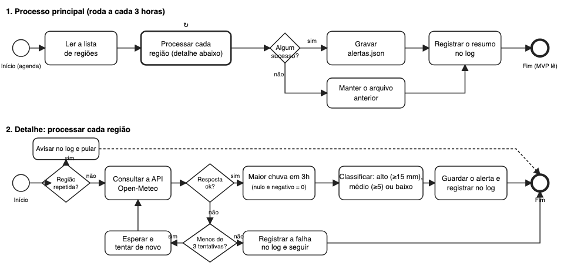

# RPA: alertas de chuva

Vinicius Barros, RM 97824 (FIAP, Global Solution 2026, Robotic Process Automation)

Esta automação faz sozinha o que antes era feito na mão: a cada 3 horas ela vê a previsão de chuva de 5 regiões de São Paulo, diz se o risco é alto, médio ou baixo e grava o resultado em `mvp/data/alertas.json`. O site do ChuvaRota lê esse arquivo e mostra na tela.



## Como funciona
- **De onde vem:** uma lista de regiões (em `src/rpa.py`) e a previsão do Open-Meteo, que é aberta e não pede chave.
- **Para cada região:** soma a chuva de 3 horas seguidas e pega o maior valor. 15 mm ou mais é risco alto, de 5 a 15 mm é médio e abaixo disso é baixo.
- **Se algo der errado:** região repetida é ignorada, a previsão fora do ar é tentada 3 vezes e o erro vai para o log, valor vazio ou negativo vira 0, e se nenhuma região funcionar o arquivo anterior continua valendo.
- **Registro:** `logs/rpa.log` guarda hora, região, chuva, risco e erros. Não tem nenhum dado pessoal.
- **Quando roda:** o `.github/workflows/rpa.yml` (GitHub Actions) roda a cada 3 horas e salva o resultado aqui no repositório.

## Como rodar
```
pip install requests pytest
python rpa/src/rpa.py
pytest rpa/tests
```

## O que tem nas pastas
- `src/`: o código
- `tests/`: os testes e o resultado deles
- `logs/`: o log de verdade e exemplos de sucesso e de falha
- `docs/`: o desenho do fluxo (BPMN) e o `PDD.md`, que descreve o processo
- `assets/`: imagens e o vídeo

## Links
- Código: https://github.com/ViniciusBarrosFiap/chuvarota/tree/main/rpa
- Vídeo (até 3 min): https://github.com/ViniciusBarrosFiap/chuvarota/blob/main/rpa/assets/video_rpa.mp4
- Relatório em PDF: https://github.com/ViniciusBarrosFiap/chuvarota/blob/main/rpa/docs/relatorio_rpa.pdf
